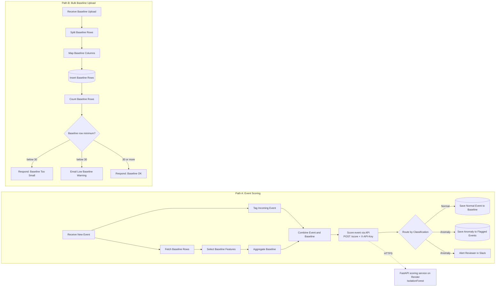
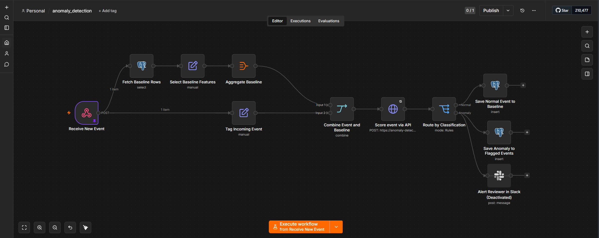
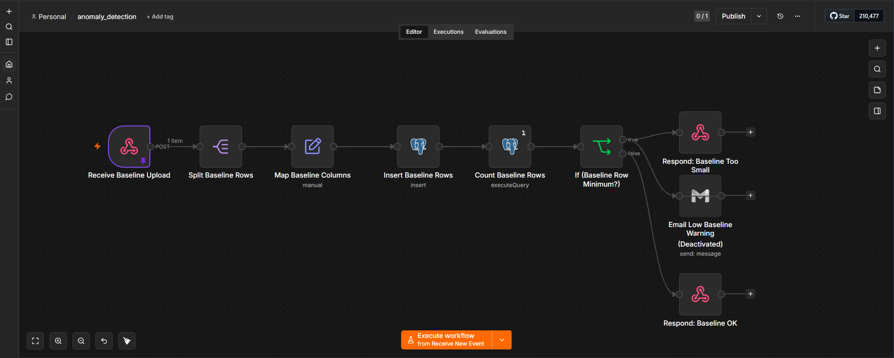

# Real-Time Anomaly Detection Pipeline


An event-driven anomaly detection system. Incoming events are scored in real time against a
historical baseline by an Isolation Forest model that runs as a deployed web service. An n8n
workflow orchestrates the data flow, stores results in PostgreSQL, and routes each event to the
right outcome.

## Why this exists

Most anomaly detection demos train a model on the same batch of data they are scoring, so every
event is effectively compared with itself. This project separates the two: a **baseline table**
holds historical "normal" data, and each new event is scored against that baseline, never against
itself. Anomalies are deliberately kept out of the baseline so the model does not drift toward the
very behaviour it is meant to catch.

## Architecture



### Path A: event scoring

1. **Receive New Event** accepts the event over a webhook.
2. Two things happen in parallel: **Tag Incoming Event** wraps the event as `new_event`, and
   **Fetch Baseline Rows** pulls the current baseline from Postgres, which is then trimmed to the
   feature columns and aggregated into one array.
3. **Combine Event and Baseline** merges both into a single item.
4. **Score event via API** sends the baseline and the new event to the deployed FastAPI service
   over HTTPS, authenticated with an `X-API-Key` header.
5. **Route by Classification** branches on the result:
   - **Normal**: **Save Normal Event to Baseline** inserts the event into `baseline`, so the
     historical set grows.
   - **Anomaly**: **Save Anomaly to Flagged Events** inserts it into `flagged_events` with its
     anomaly score, and **Alert Reviewer in Slack** notifies a human for review.

### Path B: bulk baseline upload

Seeds or backfills the baseline in bulk.

1. **Receive Baseline Upload** accepts an array of rows. The webhook is set to respond through a
   Respond to Webhook node, so the caller gets a real answer.
2. **Split Baseline Rows** turns the array into one item per row, **Map Baseline Columns** shapes
   them, and **Insert Baseline Rows** writes them to `baseline`.
3. **Count Baseline Rows** runs `SELECT COUNT(*)::int AS count FROM baseline;` once per request.
4. **If (Baseline Row Minimum?)** compares the count with the minimum of 30:
   - **Below 30**: **Respond: Baseline Too Small** returns a warning, and
     **Email Low Baseline Warning** is intended to notify whoever supplied the data.
   - **30 or more**: **Respond: Baseline OK** returns `ready_for_scoring: true`.

### Alert nodes

The Slack and Gmail nodes are placed in the workflow but **disabled** and shipped without
credentials. Everything else runs end to end without them. To enable them, attach your own
credentials and press `D` on each node to switch it back on.

## Scoring service

A stateless FastAPI app wrapping scikit-learn's `IsolationForest`. It receives the baseline with
every request, fits on it, and scores the new event against it, so there is no model file to host
or keep in sync.

| Item | Detail |
|---|---|
| Endpoint | `POST /score` |
| Auth | `X-API-Key` header, checked against the `API_KEY` environment variable. Missing or wrong key returns `401`. |
| Validation | Pydantic request models |
| Output | Classification and a continuous anomaly score |
| `MIN_BASELINE_SIZE` | 30, the minimum baseline needed for a valid score |
| `CONTAMINATION` | 0.10 |

Interactive API docs are available at `/docs` on the running service.

## Tech stack

| Layer | Tool | Why |
|---|---|---|
| Orchestration | n8n (self-hosted via npm) | Visual workflow control, webhook triggers, native Postgres, Slack and Gmail nodes |
| Scoring | FastAPI + scikit-learn | `IsolationForest` behind an HTTP API, kept outside the workflow tool so it is testable on its own |
| Hosting | Render (free tier) | Deploys directly from this repo and gives the model a real public HTTPS endpoint |
| Storage | PostgreSQL | Real SQL for baseline queries and row counts. Google Sheets (API rate caps) and n8n Data Tables were ruled out for scale. |
| Alerting | Slack (anomalies), Gmail (data quality) | Different alert types for different audiences |

## Database schema

```sql
CREATE TABLE baseline (
    id               SERIAL PRIMARY KEY,
    traffic_volume   NUMERIC,
    response_latency NUMERIC,
    recorded_at      TIMESTAMP DEFAULT now()
);

CREATE TABLE flagged_events (
    id               SERIAL PRIMARY KEY,
    traffic_volume   NUMERIC,
    response_latency NUMERIC,
    anomaly_score    NUMERIC,
    flagged_at       TIMESTAMP DEFAULT now(),
    reviewed         BOOLEAN DEFAULT false
);
```

`id`, `recorded_at`, `flagged_at` and `reviewed` are generated by the database. The workflow
inserts only the data columns and must never map `id`.

## Repository layout

```
.
├── fastapi-service/       # main.py, requirements.txt
├── n8n-workflows/         # anomaly_detection.json (credentials stripped)
├── sql/                   # table creation scripts
├── docs/                  # canvas screenshots
├── .gitignore
└── README.md
```

## Setup

### 1. Database

Create a PostgreSQL database and run the schema above.

### 2. Deploy the scoring service on Render

1. Push `fastapi-service/` to GitHub.
2. On render.com choose **New, Web Service** and select the repo.
3. Settings:
   - **Root Directory**: the folder containing `main.py` (blank if it is at the repo root)
   - **Build Command**: `pip install -r requirements.txt`
   - **Start Command**: `uvicorn main:app --host 0.0.0.0 --port $PORT`
   - **Instance Type**: Free
4. Environment variables:
   - `API_KEY`: a long random secret. Generate one in PowerShell:
     ```powershell
     [guid]::NewGuid().ToString("N") + [guid]::NewGuid().ToString("N")
     ```
   - `PYTHON_VERSION`: the Python version you developed with, for example `3.11.9`
5. Once the service shows **Live**, open `https://<your-service>.onrender.com/docs`, click
   **Authorize**, and test `/score`.

On the free tier the service sleeps after about 15 minutes idle, so the first request after a
quiet period can take 30 to 60 seconds. The workflow's HTTP Request node uses a 90 second timeout
and retry on fail to absorb this.

### 3. Run n8n (Windows)

```powershell
n8n start
```

The editor opens at `http://localhost:5678`.

### 4. Import the workflow

Import `n8n-workflows/anomaly_detection.json` through the `...` menu, **Import from File**. The
file ships without credentials or saved test data, so the nodes show credential warnings until you:

1. Attach your own **Postgres** credential to every Postgres node.
2. Create a **Header Auth** credential with name `X-API-Key` and your key as the value, and attach
   it to **Score event via API**.
3. Set that node's URL to `https://<your-service>.onrender.com/score`.
4. In the HTTP Request node, set the timeout to `90000` and turn on **Retry On Fail**.
5. Optionally attach Slack and Gmail credentials and enable the two alert nodes.

### 5. Run the scoring service locally instead (optional)

```powershell
cd fastapi-service
python -m venv .venv
.\.venv\Scripts\python.exe -m pip install -r requirements.txt
$env:API_KEY = "testkey123"
.\.venv\Scripts\python.exe -m uvicorn main:app --port 8000
```

Point the n8n HTTP Request node at `http://127.0.0.1:8000/score` and use the same key.

## Testing

Use the webhook's test URL while the workflow is in test mode. Replace the path with the one shown
in your **Receive New Event** node.

```powershell
# A normal-looking event, expected to route to Normal
curl.exe -X POST http://localhost:5678/webhook-test/<your-path> `
  -H "Content-Type: application/json" `
  -d '{"traffic_volume": 120, "response_latency": 340}'

# An extreme event, expected to route to Anomaly
curl.exe -X POST http://localhost:5678/webhook-test/<your-path> `
  -H "Content-Type: application/json" `
  -d '{"traffic_volume": 5000, "response_latency": 4000}'
```

Expected results: a new `baseline` row for the first, a `flagged_events` row for the second, and
a green execution in n8n for both. For Path B, post an array of rows to the **Receive Baseline
Upload** test URL and check the JSON it returns.

## Key engineering decisions

- **Baseline, not self-comparison.** Scoring against a persistent baseline avoids the subtle bug of
  fitting and scoring the same batch.
- **Anomalies never enter the baseline.** Only events classified Normal are written back, which
  prevents drift toward anomalous behaviour.
- **Model as a deployed microservice.** n8n's Python Code node hit an unresolved upstream bug on
  Windows npm installs (`Virtual environment is missing from this system`). Moving scoring into
  FastAPI sidestepped it, keeps the logic testable in isolation, and made it deployable.
- **Stateless scoring.** The baseline travels with each request, so the service holds no state and
  can restart, sleep or scale without a model file to persist.
- **API key on the public endpoint.** Once deployed, the service is reachable by anyone. The key is
  stored as a Render environment variable and an n8n credential, never in the repo.
- **Two separate webhooks.** Event scoring and bulk baseline upload have different payloads and
  failure modes, so each has its own entry point.
- **Responses on the upload path.** Path B answers through Respond to Webhook nodes, so the caller
  learns whether the baseline is large enough to score.
- **Database-generated ids.** Mapping `id` from the workflow caused duplicate key errors, because an
  empty value was sent as `0`. The column is left to Postgres.
- **Credential-free export.** The published workflow JSON has credentials, saved test data and the
  live service URL stripped before it goes into the repo.

## Known limitations

- n8n runs locally, so the webhooks are reachable only from the machine running it. Only the
  scoring service is publicly hosted.
- The Slack and Gmail alert nodes are present but disabled until credentials are supplied.
- The low-baseline email is not yet routed to the submitter. It needs a submitter email field in
  the upload payload.
- On Render's free tier, the first request after idle is slow because of the cold start.

## Roadmap

- Host n8n so both webhooks are publicly reachable.
- Enable the Slack and Gmail alerts and route the low-baseline email to the actual submitter.
- Add a review step so analysts can mark `flagged_events` rows as reviewed.
- Add a local LLM (Ollama) to generate plain-language summaries of flagged events.
- Build a small agent loop on top of the scoring service.

## Screenshots



